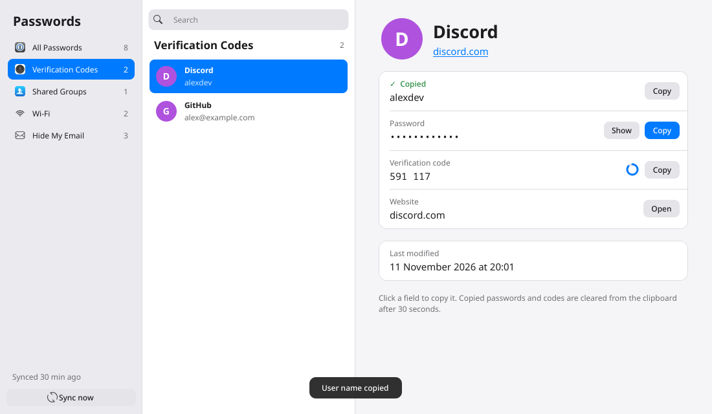

# iCloud Keychain for Linux

**Unofficial** client for iCloud Keychain. Sign in with your Apple ID and
`icp` registers this computer as one of your Apple devices, then downloads your passwords into a
private, encrypted store on your machine. A browser extension fills them in for you, just like the
Passwords app on a Mac or iPhone. Your Hide My Email addresses show up too. This project is a 
reverse engineering attempt and **is not affiliated with Apple in any way**.

> This is **untested** with Advanced Data Protection enabled. Any help with this will be appreciated -
> let me know if you have any issues with ADP enabled (also lmk if it works). Please don't spam escrow attempts!

## What you'll need

A configured Anisette server:

- [anisette-rs](https://github.com/Sank6/anisette-rs) (**recommended**) runs natively on Linux -
  uses Windows iCloud headers.
- [Anisette-on-Wine](https://github.com/Sank6/Anisette-on-Wine) runs the Windows iCloud
  libraries locally under Wine.
- [omnisette-server](https://github.com/SideStore/omnisette-server) runs locally on Linux
  (including via Docker) using libraries from the Android Apple Music APK, and can also be
  hosted on a remote server.

You can also use any trusted third-party anisette server.

```
export ICP_ANISETTE_URL="https://your-anisette-server.example"
```

The configured URL must return anisette headers as JSON to a `GET` request. Its
`/v3/client_info` endpoint must return `client_info` and `user_agent`.

## Install

From the project folder:

```
python3 -m venv .venv && .venv/bin/pip install -e .
source .venv/bin/activate
```

## Sign in

```
icp login
```

This will walk you through the login: enter your Apple ID, password, and the 2FA code Apple
sends to your other devices. `icp` then asks for a **device passcode or iCloud Security Code** so
it can join your keychain.

- You're only asked for your password and 2FA code **once**. `icp` should stay signed in for a year after this.
- The passcode step is **important and can't be undone**: entering the wrong passcode too many
  times (about 10) will permanently lock your keychain recovery. One correct entry is
  perfectly safe.
- Your 2FA code and passcode are used immediately and **never saved**. Your password is kept
  **encrypted on your computer** (in your login keyring) so `icp` can stay signed in without
  asking you again - it never leaves your machine. Your access tokens and passwords are stored
  the same way.

## Browse your passwords

```
icp show
```

Opens a full-screen list - start typing to filter, **Enter** to reveal a password,
**Ctrl+P** / **Ctrl+U** to copy the password / username to the clipboard, **Esc** to quit. Add a word to search directly, or `--plain` for plain text:

```
icp show github
```

## Desktop app

`icp-gui` is a desktop window over the same vault: search, copy, live verification codes, Wi-Fi
networks, shared groups and Hide My Email addresses, with a **Sync now** button. Click a field
to copy it. The app follows the system light or dark setting.



Install it (Qt via PySide6) and add it to your application menu:

```
.venv/bin/pip install -e '.[gui]'
desktop/install.sh
```

**Settings** has a setup checklist (anisette server, sign-in, sync, keyring, browser
helper, menu entry) with one-click fixes or a command to copy, plus the theme (automatic,
light or dark), how long copied passwords stay on the clipboard, the anisette server address,
and switches to start the anisette service and the app at login. Copied passwords and codes are hidden from KDE's clipboard history and
cleared after 30 seconds. Keyboard: **Ctrl+F** search, **Ctrl+C** copy password (from the
list), **Ctrl+B** copy username, **Ctrl+T** copy code, **Ctrl+R** sync. Signing in stays in the
terminal (`icp login`).

## Verification codes

If a login has an authenticator code set up in the Passwords app, `icp` picks it up too. `icp show`
lists the current 6-digit code next to the login with the seconds left before it changes, counting
down live.

## Set up the browser extension

The `extension/` folder works in Chromium based browsers and Firefox.

### Chrome, Chromium, Helium, or Brave

1. Open your browser's extensions page (e.g. `chrome://extensions`, `helium://extensions`) and turn on **Developer
   mode**.
2. Click **Load unpacked** and choose the `extension/` folder. Copy the **Extension ID** it shows.
3. Connect the extension to `icp` by running:

   ```
   host/install.sh <EXTENSION_ID>
   ```

4. Reload the extension. Click its toolbar icon - you'll see the logins for the current site.

### Firefox

1. Open `about:debugging#/runtime/this-firefox`, click **Load Temporary Add-on...**, and choose
   `extension/manifest.json`. (Firefox removes temporary add-ons when it restarts, so you'll need
   to re-load it after restarting.)
2. Connect it to `icp`:

   ```
   host/install.sh
   ```

3. Click the toolbar icon to see logins for the current site.

If you ever move this project to a different folder, just run `host/install.sh` again.

## Filling in passwords

- On a sign-in page, click the username or password box - an **iCloud Passwords** dropdown appears
  with matching logins. Click one to fill it in (it handles email-first pages like Google too).
- Start typing to narrow the list.
- Or click the extension's toolbar icon and pick a login there.
- On a **two-factor code** box, the dropdown offers the current code instead - click to fill it.
  Pages that split the code across six separate boxes are filled a digit at a time. The code is
  always regenerated at the moment you click, so it is never a stale one, and the toolbar popup
  shows the code next to each login (click it to copy).

## Keeping your passwords up to date

Your passwords are a snapshot, so new or changed ones need a refresh. This happens
**automatically** in the background whenever the snapshot is more than 6 hours old - you don't have
to do anything. To refresh right now:

```
icp sync
```

Syncs are paced so Apple is never hammered: at most one every 5 minutes (`--force` skips that),
and after a failure the next try waits longer (5 min, 10, 20 ... up to 6 h, or whatever Apple's
`Retry-After` asks for). Background syncs (`icp sync --background`, used by the browser helper and
timers) never sign in with your password and never trigger a verification code on your devices -
if your sign-in has expired they stop and wait for `icp login`. `icp status` shows the state.

Shared password groups you created in the Passwords app are synced too; groups someone else
shared with you are not yet.

## All commands

```
login    sign in, join your iCloud Keychain, and download your passwords
show     browse and search your passwords and Hide My Email addresses
sync     refresh your passwords now (--background for unattended runs, --force)
status   last sync, next allowed sync, whether a login is needed (--json)
diag     read-only diagnostics: zones, groups (counts only, no secrets)
logout   sign out (use --wipe-device to also forget this device)
```

`icp-gui` opens the desktop app.

## Credits

The GrandSlam sign-in flow is adapted from [JJTech's reference](https://gist.github.com/JJTech0130/049716196f5f1751b8944d93e73d3452).
The keychain decryption, Octagon trust join, and CloudKit transport follow
[OpenBubbles/rustpush](https://github.com/OpenBubbles/rustpush), cross-checked against
[Apple's open-source Security code](https://github.com/apple-oss-distributions/Security). Hide My
Email is ported from [dedoussis's browser extension](https://github.com/dedoussis/icloud-hide-my-email-browser-extension).
Machine data is provided by the configured anisette server. See `RESEARCH.md` for protocol details.
